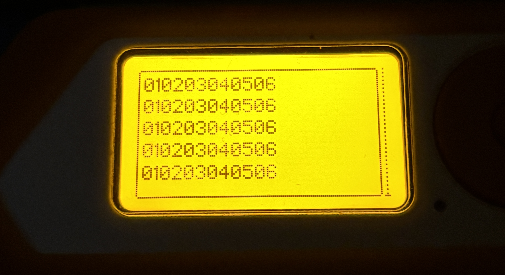
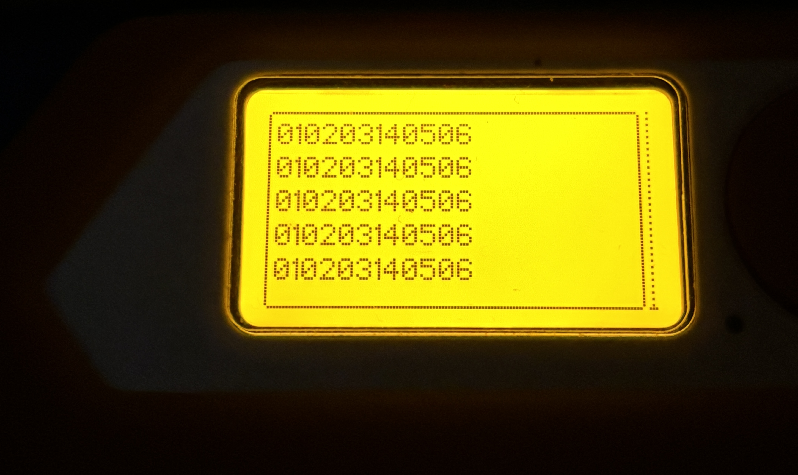

# 6 Button Esp32 based Matrix

Simple 6 button matrix control panel firmware written in C++ using the Arduino framework based on a Esp32 C3 Supermini devboard

## Required Hardware
* Esp32 C3-Supermini devboard
* 6 buttons (any type works)
* Wires (or something to wire the buttons to the microcontroller)

## Setup
This piece of code was built using [PlaformIO](https://platformio.org/)

Download the PlatformIO VSCode extension [here](https://marketplace.visualstudio.com/items?itemName=platformio.platformio-ide) or from the "Extensions" tab in VSCode

Clone this repo 

```bash
git clone https://github.com/notnotdaniel111/esp32-based-6-button-matrix
```

Make a project in VSCode with PlatformIO, from the cloned repo place the [main.cpp](src/main.cpp) into the /src folder and the [platformio.ini](ESP32_HID/platformio.ini) files into the project and then flash the devboard, after that it should work.

## Working principle

The chip sends a 12 character long string through uart and when a button is pressed down, one of the button state monitoring numbers (always an uneven character) changes.

## Example with a Flipper Zero



When fully inactive



When a button (fourth) is pressed down

## Init 

To make your job easier, there is an initialization string (############) that the device sends when it's ready.
* When you design anything using this project, I recommend only powering on the board after the main hardware (for example a Raspberry Pi) is fully booted up and are ready.

## Wiring

| Button | ESP32-C3 Pin | 
| :--- | :--- |
| **Button 1** | `GPIO 10` | 
| **Button 2** | `GPIO 4`  | 
| **Button 3** | `GPIO 3`  | 
| **Button 4** | `GPIO 7`  | 
| **Button 5** | `GPIO 6`  | 
| **Button 6** | `GPIO 5`  | 

### UART Output
| ESP32-C3 Pin | Target Device | Notes |
| :--- | :--- | :--- |
| `GPIO 21 (TX)` | `RX` | Serial transmission line |
| `GPIO 20 (RX)` | `TX` | Optional (if bidirectional and you add something to the code) |
| `GND` | `GND` | Common ground reference |

## License
This project is licensed under the MIT License - see the [LICENSE](LICENSE) file for details.
